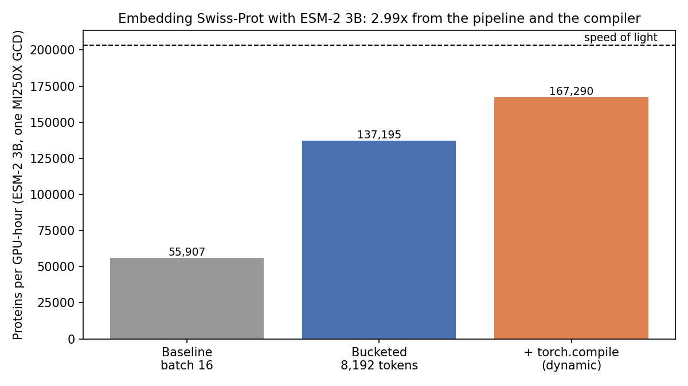
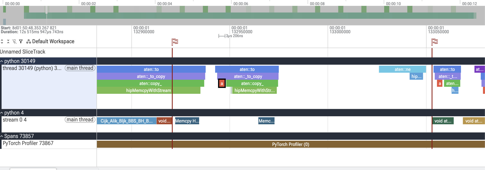

In [post 1](/blog/triton-gemm-mi250x/), I wrote a GEMM kernel in Triton and profiled it on one GCD of an AMD MI250X. In this post, we move from one kernel to a whole model: ESM-2 [1], a protein language model. Protein function pipelines often start by embedding a large number of sequences, so the question is simple: how many proteins per GPU-hour can ESM-2 3B embed on one MI250X GCD, where does the time go, and what can we fix?

This post is also a tutorial. We go step by step: estimate the ceiling, measure a baseline, profile it, decide what is worth optimizing, and optimize at three levels (the pipeline, the compiler and the kernel). Before every measurement, we will write down the prediction first, and then check where it went wrong.

**TL;DR**

- Fixing the pipeline and turning on the compiler took ESM-2 3B from 55,907 to 167,290 proteins per GPU-hour: 2.99×, from 27% to 82% of the speed of light, without writing a kernel.
- A hand-written Triton kernel (a GEMM with the GELU fused in) beat both the compiler and the vendor library on its shape, but it only buys about 3% end to end. The result is predicted by the Amdahl ranking validated by the experiments. 
  


## The data: 10,000 real proteins

The setup: one GCD of an AMD MI250X (64 GB of HBM) on the LUMI supercomputer, PyTorch 2.10 on ROCm 7.0, Triton 3.6, bf16.

I randomly sampled 10,000 proteins from Swiss-Prot [2], which has 575,748 reviewed proteins. Real proteins matter here, because the length distribution drives most of what happens later:

```text
length mean 368, median 294, p90 682, p99 1600, max 10498
longer than 1022 (truncated by ESM-2): 3.6%
```

Most proteins are a few hundred residues long, but a few are very long, and 3.6% get truncated at ESM-2's 1,022-residue window. Look at the gap between the median (294) and the p99 (1,600): any batch that contains one long protein pads all the others to its length. The timing runs use 2,000 proteins from the sample.

One note on noise: every new GPU node gives slightly different numbers, up to about 4%, for physical reasons such as clock behavior. So I only compare small effects within one session.

## Model anatomy and the speed of light

I use two sizes of ESM-2: 3B is the main model, and 650M is a comparison point. Both use rotary position embeddings and PyTorch's SDPA attention.

```text
esm2_3b   | layers 36  hidden 2560  heads 40  ffn 10240 | parameters 2839 M
esm2_650m | layers 33  hidden 1280  heads 20  ffn 5120  | parameters 651 M
```

Before running anything, I want a ceiling: the speed of light. It is the time the useful math would take if every FLOP ran at the best GEMM speed I have measured, with zero padding and zero overhead. This is a ceiling that nobody can reach, but without it a speedup has no scale: a 2× gain could be the start or the end.

### The FLOP model

One forward pass over $L$ tokens costs about

$$
\text{FLOPs}(L) \approx 2PL + 4\,n_{\text{layers}}\,L^2 d
$$

$P$ is the number of weights in the linear layers: per layer, $4d^2$ in attention (the Q, K, V and output projections) and $8d^2$ in the feed-forward block, so $P = 12\,n_{\text{layers}}\,d^2$. Each weight does one multiply and one add per token, which gives $2PL$. Attention computes $QK^{\top}$ and the weighted sum over $V$, each about $2L^2d$ per layer. A protein of $n$ residues becomes $L = \min(n, 1022) + 2$ tokens, counting the start and end tokens.

To get the speed of light, we sum this over the 10,000 real proteins and divide by the measured roof: 115.3 TFLOPS, the fastest library GEMM I measured in post 1.

```python
MODELS = {"3b": (36, 2560), "650m": (33, 1280)}    # (layers, hidden size)

def flops_for_tokens(L, model="3b"):
    layers, d = MODELS[model]
    P = 12 * layers * d * d                        # 4d² attention + 8d² FFN, per layer
    return 2 * P * L + 4 * layers * L * L * d

def flops_for_protein(n, model="3b"):
    return flops_for_tokens(min(n, 1022) + 2, model)

total = sum(flops_for_protein(len(s)) for s in seqs)    # 20.40 PFLOP
seconds = total / 115.3e12                               # 177 s for 10,000 proteins
```

```text
3b    total 20.40 PFLOP | attention share 3.2% | speed of light 177 s = 203,447 proteins per GPU-hour
650m  total  4.83 PFLOP | attention share 6.2% | speed of light  42 s = 860,116 proteins per GPU-hour
```

Attention is only 3.2% of the FLOPs at these lengths, so this is a GEMM workload. Memory is not a constraint either: the 3B weights take 2.84B × 2 bytes ≈ 5.7 GB in bf16, far below the GCD's 64 GB.

## The baseline pipeline

The baseline is the simplest pipeline: take the proteins in file order, 16 at a time, pad each batch to its longest member, and run the model. Tokenization runs inside the timer, because it is part of the real pipeline.

For each run, I record two kinds of FLOPs. Useful FLOPs count only the real tokens; computed FLOPs count every position the GPU processed, including the padding. The difference is the work spent on padding. Useful MFU is the useful TFLOPS divided by the 115.3 TFLOPS roof.

| | 3B | 650M |
|---|---|---|
| Proteins per GPU-hour | 55,907 | 176,656 |
| Share of the speed of light | 27.5% | 20.5% |
| Computed TFLOPS | 80.3 | 61.4 |
| Useful TFLOPS | 31.7 | 23.7 |
| Useful MFU | 0.275 | 0.206 |
| Padding waste | 59.5% | 59.5% |

What these numbers tell us:

1. The 3B baseline reaches only 27.5% of its speed of light.
2. Padding takes 59.5% of the GPU's work. The GPU computes at 80.3 TFLOPS, about 70% of the roof, but only 31.7 TFLOPS of it is useful. The kernels are not the main problem; the pipeline feeds them mostly zeros.
3. Even the computed TFLOPS is below the roof. My two guesses for the missing time: tokenization on the CPU between batches, and kernel launch overhead.
4. 3B is more efficient than 650M. Its GEMMs are bigger (2,560 and 10,240 wide vs 1,280 and 5,120), so fixed per-batch work like tokenization and kernel launches is a smaller part of the total.

## Remove the padding: token-budget bucketing

### The prediction before measurement

Padding is the largest loss, and also the cheapest to fix: it needs sorting, not kernels. So it goes first. Profiling the padded pipeline now would mostly measure work we are about to delete.

If bucketing removed all the padding and the GPU kept computing at 80.3 TFLOPS, the useful throughput would rise by 80.3 / 31.7 ≈ 2.5 times, to roughly 140,000 proteins per GPU-hour. Real bucketing leaves a little padding, and batches of short proteins may run less efficiently, so I expected a bit less than 2.5×.

### Token-budget bucketing

The idea is to sort the proteins by length, then fill each batch until it holds a fixed number of tokens (batch size × longest length). Short proteins are packed into big batches, long ones into small batches, and each batch is padded only to its own longest member. A fixed token budget, rather than a fixed batch size, also keeps each batch's work and memory roughly constant. The function returns indices, so each embedding can go back to its original position.

```python
def token_budget_batches(seqs, max_tokens):
    order = sorted(range(len(seqs)), key=lambda i: len(seqs[i]))
    batches, cur, cur_max = [], [], 0
    for i in order:
        L = len(seqs[i]) + 2                       # residues + start and end tokens
        if cur and max(cur_max, L) * (len(cur) + 1) > max_tokens:
            batches.append(cur)                    # adding protein i would exceed the budget
            cur, cur_max = [], 0
        cur.append(i)
        cur_max = max(cur_max, L)
    if cur:
        batches.append(cur)
    return batches                                 # indices, so the order can be restored
```

I tested three budgets on the 3B model. With full-length proteins, they would hold about 8, 16 and 32 proteins per batch, but most proteins are much shorter, so the real batches hold many more.

| Budget (tokens) | Batches | Proteins per GPU-hour | Padding waste | Useful MFU |
|---|---|---|---|---|
| 8,192 | 89 | 137,195 | 1.6% | 0.675 |
| 16,384 | 45 | 135,899 | 3.1% | 0.669 |
| 32,768 | 23 | 133,485 | 5.6% | 0.657 |

8,192 tokens is the best budget we tested: 2.45× over the baseline, close to the 2.5× prediction, with the useful TFLOPS at 77.9. Larger budgets do slightly worse, because each batch covers a wider range of lengths and pads more.

**Scoreboard:** 137,195 proteins per GPU-hour, 67% of the speed of light.

## Profile the bucketed pipeline

The padding is gone, so the next bottleneck becomes visible. Let's profile the bucketed pipeline and test our two guesses: tokenization on the CPU, and kernel launches.

### Is the CPU the bottleneck?

The first check is cheap. Tokenization alone takes 2.04 s for all 89 batches, about 23 ms per batch, or 3.9% of the 52.49 s run. If the pipeline tokenized and computed in strict turns, the GPU would sit idle for that 3.9%. Whether it really does is a question for the trace.

### Where does the GPU time go?

The PyTorch profiler records both sides: the CPU (PyTorch ops) and the GPU (kernels). I profile 20 batches after a short warm-up, print a table sorted by GPU time, and export a trace:

```python
from torch.profiler import profile, ProfilerActivity

with torch.inference_mode():
    for b in batches[:3]:                          # warm-up, not profiled
        run_batch(b)
    with profile(activities=[ProfilerActivity.CPU, ProfilerActivity.CUDA]) as prof:
        for b in batches[:20]:
            run_batch(b)
        torch.cuda.synchronize()

print(prof.key_averages().table(sort_by="cuda_time_total", row_limit=20))
prof.export_chrome_trace("results/esm_m2_trace.json")    # open in Perfetto
```

On ROCm, `ProfilerActivity.CUDA` records the GPU; PyTorch just keeps the CUDA name. The printed table mixes two kinds of rows:

- **Op rows** (`aten::...`) are PyTorch operations. They have CPU time, because the CPU dispatches them.
- **Kernel rows** (`Cijk_...`, `attn_fwd`, `void at::native::...`) are the GPU kernels those ops launch. Their Self CPU time is 0, which is how you spot them.

The time columns come in pairs too: "Self" is the time in that row alone, and "total" includes everything it calls. One `nn.Linear` gives this chain:

```text
aten::linear            (Self CUDA 0,        CUDA total 8.759 s)
  └─ aten::addmm        (Self CUDA 8.759 s,  CUDA total 8.759 s)
       └─ Cijk_..._Bias kernel  (8.758 s on the GPU)
```

The same 8.76 s of GPU time appears on three rows, so adding up the "CUDA total" column counts it three times. Add up the kernel rows (or the Self CUDA column) instead, and then group the kernels into a few buckets. For ESM-2, four buckets are enough:

| Bucket | What is counted | Time (ms) | Share |
|---|---|---|---|
| GEMM | `addmm` (Tensile `Cijk` kernels) | 8,759 | 74.0% |
| Elementwise and norm | `mul` 829 + `add` 611 + `erf` 279 + `layer_norm` 200 | 1,920 | 16.2% |
| Other | `cat` 313 + the rows below the top 20 (422) | 735 | 6.2% |
| Attention | SDPA's fused kernel, `attn_fwd` | 422 | 3.6% |
| **Total (20 batches)** | | **11,835** | **100%** |

The `Cijk_...` kernels are Tensile GEMM kernels, which the ROCm BLAS libraries call. For attention, SDPA chose `_efficient_attention_forward`, a fused kernel that never stores the batch × heads × L² score matrix.

GEMMs dominate, as the FLOP model predicted, and they already run well. About 98% of the FLOPs are in GEMMs, but GEMMs take only 74% of the time. The run computed 79.2 TFLOPS on average, so the GEMM kernels run at about 0.98 × 79.2 / 0.74 ≈ 105 TFLOPS, about 91% of the roof.

One more check: the GPU time per batch is 11,835 ms / 20 ≈ 590 ms, and the wall time per batch is 52.49 s / 89 ≈ 590 ms. If tokenization added its 23 ms on top, the wall time would be about 613 ms per batch. So tokenization does not add to the run time. The trace shows why.

### How to read a trace in Perfetto

The table tells us how much time each kernel takes. The trace tells us when things happen, on the CPU and the GPU side by side, which is what we need to see whether the GPU ever waits.

Open [ui.perfetto.dev](https://ui.perfetto.dev) and drag the exported JSON file into the page. Keep the profiled window short: 20 batches already give a 12.5 s trace. Use **W** and **S** to zoom in and out around the mouse pointer, and **A** and **D** to move left and right. Click a slice to see its name, start time and duration in the bottom panel, and drag across a region to measure a time range. Clicking in the narrow bar above the tracks drops a flag; the red flags in Fig. 3 are made this way.

The trace is shown as rows, called tracks. Three of them matter here (Fig. 2):

- **python 30149 / thread 30149 (main thread)** is the CPU. Each slice is a PyTorch op or runtime call on the Python main thread, and slices stack by call depth: the outer op is on top, the functions it calls are below. In Fig. 2, `aten::to` calls `aten::_to_copy`, which calls `aten::copy_`, which calls `hipMemcpyWithStream`.
- **python 4 / stream 0** is the GPU. Each slice is a kernel or a memory copy on stream 0, where all our work runs. White space here means the GPU is doing nothing.
- **PyTorch Profiler** is the window during which the profiler was recording.

The width of a slice is its duration, and the time axis is shared, so anything directly above a GPU slice happened on the CPU at the same moment.

We need one more idea before reading the picture: the CPU and the GPU run asynchronously. When PyTorch launches a kernel, the CPU puts it into the stream's queue and moves on, and the GPU runs the queued kernels later, in order. So a kernel appears on the GPU track to the right of the CPU op that launched it, sometimes much later. As long as the CPU stays ahead, the queue never runs empty and the GPU never waits. The CPU only waits when it needs something from the GPU, such as a result or a blocking copy. In a trace, that wait is a long CPU slice that ends at exactly the moment the GPU finishes its last queued kernel.

With this, let's read the batch boundary in Fig. 2. The green dashed line marks where batch N ends on the GPU.

. Top track: the CPU (Python main thread). Bottom track: the GPU (stream 0). The numbered notes walk through the handover from batch N to batch N+1.")

Start on the CPU track, at (1). The CPU is inside `hipMemcpyWithStream`, copying batch N+1's inputs to the GPU. This is a blocking copy in the same queue as the kernels, so it cannot run until every kernel of batch N has finished. The CPU sits in this call for about 500 ms, and almost none of that is copying: it is waiting. So the CPU is about 500 ms ahead of the GPU.

Now look straight down at (2): on the GPU track, batch N ends with a GEMM (`Cijk_...`) and an elementwise kernel (`void at::native::...`). The last kernel ends and the CPU's copy returns at the same instant, on the dashed line. That alignment is the signature of a synchronization, and it marks where one batch hands over to the next.

After the boundary, at (3), the CPU starts batch N+1: a second short `aten::to` (probably the attention mask), then many small ops, one kernel launch each. The white space between them is Python code that the profiler does not record. At (4), the first ops launch tiny kernels that finish faster than the CPU can launch the next one, so the GPU idles in short stretches: about 0.3 ms in total, of which about 0.18 ms is fully idle. At (5), the kernels become longer than the CPU's launch interval, the queue fills up, and the GPU stays busy for the rest of batch N+1, about 590 ms.

Fig. 3 zooms in further, with two flags: one at the end of batch N's last kernel, one at the first compute kernel of batch N+1. They are 0.13 ms apart. In between, the GPU runs no compute; it only copies batch N+1's two inputs from host to device (12 µs and about 8 µs, likely the `input_ids` and the attention mask), with about 30 µs idle between them. The CPU track shows why: the first `hipMemcpyWithStream` returns at the first flag, then the CPU issues the second copy, then starts the forward pass (`aten::ne`), and only then does the first kernel reach the GPU.



### What the trace tells us

Now we can answer both guesses.

- **Tokenization.** The CPU is about 500 ms ahead, and a batch tokenizes in about 23 ms, so tokenization is done long before the GPU needs it. It costs CPU time but is not on the critical path, as the per-batch check above already suggested.
- **Kernel launches.** Launch overhead only shows up in the first fraction of a millisecond of each batch, while the queue is empty and the kernels are tiny. After that, the kernels are long enough to hide the launches. A small model or tiny batches would look different: a launch-bound trace shows short kernels separated by gaps all the way through.

The whole boundary costs about 0.34 ms of a 590 ms batch, about 0.06% of the run. Both of my guesses were wrong. The GPU is busy almost all the time, so the time we can save is inside the kernels, and the profiler table is the right map.

## The Amdahl ranking: what is worth optimizing?

Why do we care about this? Because the profile tells us where the time goes, but not what to work on. A 3× speedup on something that takes 2% of the time saves almost nothing, while a 1.5× speedup on something that takes 60% of the time saves a lot. Amdahl's law [3] puts this into one formula: if a part takes a share $f$ of the total time and you speed it up by $s$, the time you save is

$$
f \times \left(1 - \frac{1}{s}\right)
$$

$f$ comes from the profile. The problem is $s$: how do we know how much faster something can get before we try? Here are three ways to estimate it:

1. **Roofline headroom**, for compute-bound work like GEMMs [4]. A kernel cannot beat its roof, so $s_{\max}$ = roof / achieved. A kernel at 90% of its roof can get at most 1 / 0.9 ≈ 1.11× faster.
2. **Memory-traffic counting**, for memory-bound work like elementwise ops. These kernels do almost no math, so their time is the time to read and write the tensor in HBM. A chain of $k$ unfused ops reads and writes the tensor $k$ times; fused, once. So $s \approx k$.
3. **Hiding**, for work that can overlap with the GPU. If it leaves the critical path entirely, $s = \infty$ and the time saved is $f$. But only the part of $f$ on the critical path counts.

| Target | $f$ | Achievable $s$ | Time saved |
|---|---|---|---|
| Elementwise and norm | 16.2% | ≈ 2.5 (traffic counting) | ≈ 9.7% |
| GEMMs | 74.0% | ≈ 1.05, at most 1.10 (roofline) | ≈ 3.5%, at most 6.6% |
| Attention | 3.6% | ≈ 1.2 (judgment) | ≈ 0.6% |
| CPU tokenization | ≈ 0.06% | ∞ (hiding) | ≈ 0 |

How I got each $s$:

- **Elementwise and norm, ≈ 2.5.** GELU runs as `erf`, `mul` and `add` on the 10,240-wide FFN tensor, about 4 passes over the same data (fused: 1). The rotary embedding runs `mul`, `cat`, `neg` and `add` on Q and K, about 5 passes. The residual add and LayerNorm are already single kernels and gain little, about 1 to 2×. Weighting these, about 2.5× for the bucket is a fair middle estimate, and $s$ between 2 and 3 would save 8 to 11%. A bonus: the `cat` in "Other" (2.6%) is part of the rotary chain, so fusion should remove it too.
- **GEMMs, ≈ 1.05.** At 91% of the roof, the ceiling is 115.3 / 105 ≈ 1.10, and realistic tuning only gets part of it.
- **Attention, ≈ 1.2.** SDPA already uses a fused kernel. A better one might gain 10 to 30%, and even an infinite speedup would save only 3.6%.

That is why GEMMs rank second even though they take 4.6× more time than the elementwise bucket: they are already near their roof. The top target is fusing the elementwise chains, and the cheapest way to get fusion is to let the compiler do it.

## torch.compile

### How much speedup do we expect?

If Inductor, the compiler behind `torch.compile` [5], speeds up the 16.2% elementwise bucket by 2.5× and changes nothing else, the time drops by 0.162 × (1 − 1/2.5) = 9.7%: about 1.11× more proteins per GPU-hour.

### The pitfall of torch.compile

`torch.compile` specializes the generated code to the input shapes it sees. Our bucketed pipeline has 89 batches, and almost every one has a different shape (batch size × length). Each new shape triggers a new compilation, and after 8 of them PyTorch gives up and silently falls back to eager mode for new shapes. There are two fixes: mark the shapes as dynamic, so one compiled graph handles any shape, or round the lengths up to a few standard sizes.

| Mode | Proteins per GPU-hour | vs eager | Compile + first pass | Recompilations |
|---|---|---|---|---|
| Eager | 142,268 | 1.00× | 51.8 s | 0 |
| Static | 142,269 | 1.00× | 343.6 s | 8 |
| Dynamic | 167,290 | 1.18× | 140.2 s | 0 |

Static compile is exactly as fast as eager, because it hit the recompile limit and quietly ran most batches in eager mode. If I had not checked the recompilations, I would have concluded that the compiler does not help.

Dynamic compile did not work at first either. It also logged 8 recompilations and fell back to eager, which I did not expect. The recompile log (`TORCH_LOGS="recompiles"` prints it) showed the cause: every guard failure was on `rotary_embeddings._seq_len_cached`. The Hugging Face ESM rotary embedding caches its cos and sin tables and stores the cached length in a Python integer on the module. `torch.compile` treats integer module attributes as constants, so each new length broke the guard and forced a recompile, whatever `dynamic=True` said about the tensors.

The fix was a stateless `RotaryEmbedding.forward` that rebuilds the tables on every call. The cache never helped here anyway, because the length changes at almost every batch. The patched model's output is bit-identical to the original (rtol = 0, atol = 0). With the patch, dynamic compile runs with 0 recompilations and reaches 167,290 proteins per GPU-hour: 1.18× over eager in the same session, 2.99× over the baseline. The cold compile takes about 2 minutes (about 80 s with a warm cache), which is nothing for a job measured in GPU-hours.

### A fixed-shape microbenchmark

The pipeline number mixes two questions: how good Inductor's kernels are, and how well compilation copes with changing shapes. To separate them, we time one fixed batch of [16, 512], exactly the 8,192-token budget:

```text
eager           584.53 ms per forward
default         489.79 ms per forward
max-autotune    487.33 ms per forward
```

At a fixed shape, compiling gives 1.19×; the dynamic pipeline gets 1.18×. So dynamic shapes kept about 91% of the kernel gain (17.6% of 19.3%), and fixed-size buckets could recover at most about 1.5%. Not worth it. Max-autotune brought almost nothing here: 0.5% over the default mode.

### What did Inductor fuse?

To see what Inductor generated, run with `TORCH_LOGS="output_code"`. The kernel names tell you what was fused: the prefix gives the kind of kernel (`poi` = pointwise, `red` = reduction, `per` = persistent reduction), and the rest lists the PyTorch ops inside. Three examples:

```text
triton_poi_fused_add_addmm_div_erf_mul_view_6
triton_red_fused_add_addmm_native_layer_norm_view_7
triton_poi_fused__scaled_dot_product_efficient_attention__to_copy_add_arange_cat_cos_expand_mul_neg_rsub_sin_split_transpose_unsqueeze_view_3
```

The first is the up-projection's bias add plus exact GELU, x · 0.5 · (1 + erf(x / √2)), in one pass. The second is a linear layer's bias, the residual add and the next LayerNorm. The third is the whole rotary embedding (with the patched table rebuild) plus the reshape into the head layout SDPA expects, so the rotary `cat` is gone. The input stage (embedding lookup, ESM's token-dropout scaling, mask prep and the first LayerNorm) is one kernel too.

What Inductor did not do matters as much. The GEMMs are still library calls: the default mode generates no Triton GEMMs (no `triton_tem_` kernels). Inductor splits each `addmm` into a library matmul plus a bias add and moves the bias into the next fused kernel. So the GELU is still a separate pass that reads the FFN output back from memory.

### Profile the compiled pipeline

| Bucket | Eager (ms) | Compiled (ms) |
|---|---|---|
| GEMM | 8,759 | 8,722 |
| Elementwise and norm | 1,920 | 887 |
| Other | 735 | 9 |
| Attention | 422 | 491 |
| **Total (20 batches)** | **11,835** | **10,109** |

What the comparison shows:

- GEMMs did not change (8,759 → 8,722 ms). Their share rose from 74% to 86% only because everything around them shrank.
- Elementwise time fell 2.2× (1,920 → 887 ms), close to the 2.5× I assumed.
- "Other" almost vanished (735 → 9 ms). The casts, copies and embedding lookup are now inside fused kernels. My 1.11× prediction left this bucket out, and that is where the extra speedup came from.
- Total GPU time fell 1.17×, matching the measured 1.18×. The profile and the stopwatch agree.
- Attention got slower (422 → 491 ms). It may be node drift, or Inductor handing SDPA its inputs in a different memory layout. I leave it open.

Here is the new Amdahl ranking. I added a column for the cost of each fix, because the costs are now very different:

| Target | $f$ (GPU time) | Achievable $s$ | Time saved | Cost of the fix |
|---|---|---|---|---|
| GEMMs | 86.3% | ≈ 1.05, at most 1.10 | ≈ 4.1%, at most 7.7% | very high: already vendor-tuned |
| GELU pass | 3.7% | large, minus the erf cost | ≤ 3.7% (realistic 2 to 3%) | medium: one kernel, per shape |
| Attention | 4.9% | ≈ 1.16 (recover the regression) | ≈ 0.7% | medium: investigate the Q/K/V layout |
| Residual + LayerNorm | 2.9% | ≈ 1 (already fused) | ≈ 0 | n/a |
| Rotary + attention prep | 2.1% | ≈ 1 (already fused) | ≈ 0 | n/a |

The GEMMs still have the largest possible saving, but getting it means beating a vendor-tuned library on every shape. The GELU pass is the largest target that one kernel can fix, by fusing the GELU into the GEMM itself. That is the Fusion lab below.

**Scoreboard:** 167,290 proteins per GPU-hour, 82% of the speed of light.

## A detour: the tokenization stall that was not there

Before the Fusion lab, I took a wrong turn, and I think it is worth showing.

While setting up the compile experiments, I tested tokenization once more: I tokenized everything in advance, and the run time went from 52.5 s to 50.5 s, exactly 2 s less. I concluded that tokenization was stalling the GPU by about 3.8%, even though the trace had shown the opposite. So I built a fix: tokenize the next batch in a background thread while the GPU works, and put the result in pinned memory, which allows an asynchronous copy.

The prefetch version reached 166,476 proteins per GPU-hour, about 1.00×. Nothing changed. Then I noticed that the compiled run (167,290) had tokenized everything before the timer started. For a fair comparison, I ran three modes in one session, on a different node (so all three are a bit lower):

- all tokenization up front, outside the timer: 165,290
- tokenization per batch, inside the timer: 164,048
- per batch, in a background thread (prefetch): 165,180

All three are within 1% of each other, and the eager pipeline agrees: 51.62 s with per-batch tokenization vs 51.58 s pre-tokenized. So tokenization does not stall the GPU, and it does not matter whether it sits inside the timer. The 2 s came from comparing two runs from different sessions, inside the noise. The trace had been right all along.

The lesson: compare small effects within one session, and when a stopwatch and a trace disagree, find out why before building a fix.

## The Fusion lab: is a hand-written kernel worth it?

After compiling, the GELU pass is the largest elementwise kernel left. It still runs after the GEMM: the GEMM writes its output to memory, and the GELU kernel reads it back. A fused epilogue avoids that round trip, because the GEMM applies the bias and the GELU to its accumulator right before storing. I tested this on the FFN up-projection of one 8,192-token batch: 8,192 × 2,560 → 10,240 in bf16, with exact GELU.

### The prediction before measurement

- GEMM: 2 × 8,192 × 10,240 × 2,560 = 430 GFLOP.
- Unfused GELU traffic: 8,192 × 10,240 × 2 B = 168 MB read + 168 MB written = 336 MB, or 0.27 ms at 1.25 TB/s (the bandwidth from post 1). The profile shows about 0.52 ms per call, so it runs at about half the bandwidth.
- The fused kernel deletes that traffic, but it still has to compute the erf.
- Prediction: about the time of the GEMM alone plus a small epilogue cost, 0.3 to 0.5 ms faster than Inductor.

### Results

I wrote a Triton GEMM with the bias and exact GELU in its epilogue and timed five contestants:

| Contestant | What runs | Kernels | Time (ms) |
|---|---|---|---|
| Floor | the library GEMM only | 1 | 3.815 |
| Eager | `addmm` + separate GELU | 2 | 4.238 |
| Inductor default | `mm` + fused bias-and-GELU kernel | 2 | 4.259 |
| Fused kernel | my Triton GEMM + bias + exact GELU epilogue | 1 | **3.902** |
| GEMM alone | the same kernel, epilogue off | 1 | 3.671 |

1. **The kernel.** The fused kernel is 2.3% above the floor and beats Inductor by 0.358 ms, inside the predicted range. That splits into 0.213 ms from fusion (a 0.231 ms epilogue replaces a 0.444 ms GELU pass) and 0.144 ms from a faster GEMM (3.671 vs 3.815 ms).
2. **The model.** The GELU pass is 3.7% of the GPU time, and the kernel removes 0.358 ms of its 0.444 ms: 3.7% × 0.358 / 0.444 ≈ 3.0% end to end, about 1.8% from the fusion alone. This is an upper bound, because I tuned at M = 8,192 only.

What surprised me:

1. The epilogue costs half a separate GELU pass. Fusion removed the memory traffic, but the erf is about 0.2 ms of vector work, and it now runs while the Matrix Cores sit idle. My prediction did not include it.
2. My Triton GEMM took 3.8% less time than hipBLASLt on this shape.
3. Eager beat Inductor (4.238 vs 4.259 ms). hipBLASLt already fuses the bias, so Inductor's split of `addmm` into a matmul plus a bias add bought nothing here.

### Is there a free fix?

Before keeping a hand-written kernel, I want to know whether the compiler can do the same for free. Max-autotune lets Inductor generate its own Triton GEMMs and pick the fastest. In a separate session, on a node about 3% slower: floor 3.950 ms, Inductor default 4.403 ms, max-autotune 4.229 ms, my fused kernel 4.010 ms.

Max-autotune chose its own Triton GEMM, but it still ran the GELU as a separate kernel. So it recovers the GEMM half of my gain (0.174 ms) for free, but the fusion half (0.219 ms) remains mine, and at this shape the fused kernel is 5.5% faster than the best compiler setting. Two things stay open: why Inductor did not fuse the epilogue into its own GEMM (my hypothesis: it benchmarked the epilogue on one config only), and how max-autotune behaves with dynamic shapes. Also, on the whole model at a fixed shape, max-autotune added only 0.5%, so the free GEMM gain does not carry over automatically.

### Ship it?

For:

- About 3% end to end, and two kernels become one.
- The GEMM half could ship on its own: a faster tile configuration than the library's is worth contributing back.

Against:

- It is tuned for one shape on one GPU; MI300 has different matrix instructions and LDS sizes.
- Variable batch shapes put the GEMM part (about 1.2%) at risk, and the fusion alone is only 1.8%.
- Inductor may learn this epilogue fusion itself, which makes the maintenance cost temporary, but real.

So my answer: the kernel earns its place at this shape, but it is not worth maintaining in a production pipeline yet. The Amdahl ranking said the GELU pass could save at most 3.7% before I wrote a line of Triton, and the measurement landed inside that.

## Recommendations

If a team running this pipeline asked me what to do, this is what I would say:

1. **Ship now:** token-budget bucketing (8,192 tokens), the stateless rotary patch and dynamic `torch.compile`. Together they give 2.99×, and embedding all of Swiss-Prot drops from about 10.3 to 3.4 GPU-hours.
2. **Look next:** max-autotune per GEMM shape. It recovered the GEMM half of my kernel's gain on the isolated up-projection, but only 0.5% on the whole model at a fixed shape. Dynamic shapes are untested.
3. **Hold:** the hand-fused kernel, unless 1.8% matters at your scale and you can tune and test it across shapes and GPU generations.
4. **Open questions:** the attention regression after compiling, and why Inductor skipped the epilogue fusion.

Next, I will scale this pipeline across the 8 GCDs of one node, and then move on to OpenFold3, a structure model, on the same GPU.

## The method in one list

1. Estimate a ceiling from the model config, the real input lengths and a measured roof.
2. Count useful and computed work separately; the difference is waste.
3. Remove the biggest cheap loss first, with a written prediction.
4. Profile: sum the kernel rows, group them into buckets, and read the trace for idle time.
5. Rank the targets by $f \times (1 - 1/s)$, with a reason for every $s$.
6. Check that each tool did what you think, and that the outputs stay correct.
7. Profile again after every fix, because the bottleneck moves.
8. Before writing a kernel, look for a free fix, then scale the kernel's gain back to the whole run.

## Reproduce

Code, logs and the rotary patch are in [huizhg/gpu-perf-mi250x](https://github.com/huizhg/gpu-perf-mi250x).

```bash
python -m esm2.speed_of_light                          # the ceiling
python -m esm2.baseline --model 3b                     # file order, batch 16
python -m esm2.bucketed --model 3b --max-tokens 8192   # token-budget bucketing
python -m esm2.compiled --model 3b --max-tokens 8192 --compile dynamic  # torch.compile dynamic
python -m esm2.fusion_lab # fuse GEMM and GELU
```


